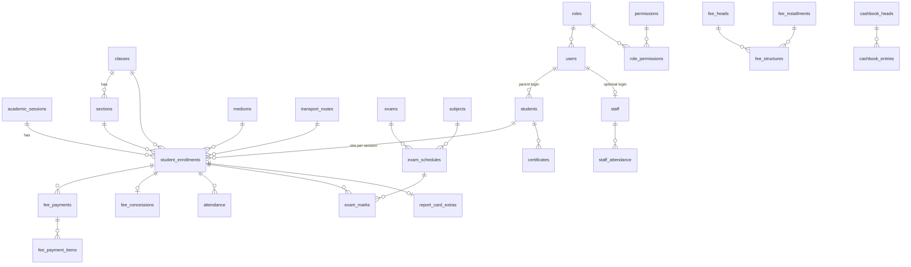

# Sunrise Maa Bharti School ERP

School management software for **Sunrise Maa Bharti Senior Secondary School, Bijoliya** — replaces the old Joomla site.
Students, fees & cashbook, attendance (with biometric machine), staff, exams & marksheets, certificates, transport,
reports and a parent portal. Every record is kept **per academic session** (and Hindi / English **medium**), so one
session's data never mixes with another's.

| Part | Stack |
|---|---|
| Backend | NestJS 11, Sequelize 6 (sequelize-typescript), MySQL 8 / MariaDB 10.4+ |
| Frontend | React 19, Vite, Tailwind CSS 3, Redux Toolkit + RTK Query (JSX), neumorphism UI |
| PDFs | Old-format documents (receipt, admit card, marksheet, certificates, fee due slip) are HTML printed by headless Chrome (`puppeteer-core`); ID cards and the PTM sheet use `pdfkit` |
| Excel | `exceljs` (student import, report exports) |

---

## Contents

1. [Folder structure](#folder-structure)
2. [Setup](#setup)
3. [Environment variables](#environment-variables)
4. [Database: migrations & seeders](#database-migrations--seeders)
5. [Logins](#logins)
6. [How the app works](#how-the-app-works)
7. [Error handling](#error-handling)
8. [Biometric machine](#biometric-machine)
9. [Database schema](#database-schema)
10. [Production checklist](#production-checklist)

---

## Folder structure

```
SUNRISE_MAA_BHARTI/
├── Backend/                 NestJS API  (port 5000, prefix /api)
│   ├── assets/              default logo used on PDFs
│   ├── src/
│   │   ├── common/          guards, decorators, filters (errors), interceptors, pdf templates, utils
│   │   ├── config/          env config + validation
│   │   ├── database/        migrations/, seeders/, sequence service
│   │   └── modules/         academic, admin, auth, students, fees, attendance, staff,
│   │                        exams, transport, communication, reports, portal
│   └── uploads/             student photos, school logo (git-ignored)
├── Frontend/                React app  (port 5173, proxies /api, /uploads, /Api to the backend)
│   └── src/
│       ├── api/             RTK Query endpoints
│       ├── app/             store, routes, auth bootstrap
│       ├── components/      common UI (cards, tables, modals, PDF viewer), layout (sidebar, header)
│       ├── modules/         one folder per feature (pages + components)
│       └── utils/           axios instance, friendly errors, formatting, files
└── joomla_site/             old site — reference only, NOT in git
```

---

## Setup

**Requirements:** Node.js 20+ (tested on 24), MySQL 8 or MariaDB 10.4+ (XAMPP works), Google Chrome / Chromium
(for PDFs), a Devanagari font on the server for Hindi PDFs (Windows has Nirmala UI; on Linux install `fonts-noto`).

```bash
# 1. database
mysql -u root -e "CREATE DATABASE school_erp CHARACTER SET utf8mb4 COLLATE utf8mb4_unicode_ci"

# 2. backend
cd Backend
cp .env.example .env          # fill DB password, JWT_SECRET, ADMIN_PASSWORD
npm install
npm run db:migrate            # creates all tables
npx sequelize-cli db:seed --seed 20261118000001-rbac-and-masters.js   # roles, permissions, mediums, super-admin
npm run db:seed:demo          # OPTIONAL demo data (180 students, fees, attendance, marks)
npm run start:dev             # http://localhost:5000/api

# 3. frontend (new terminal)
cd Frontend
npm install
npm run dev                   # http://localhost:5173
```

> `npm run db:seed` runs **all** seeders including the demo data. On a real school database use the single
> `rbac-and-masters` seeder shown above, then sign in as super admin and create the academic session
> (Academic → Sessions), classes & sections, subjects, fee heads/installments and staff from the UI.

---

## Environment variables

`Backend/.env` (copy from `.env.example`):

| Variable | Example | Meaning |
|---|---|---|
| `PORT` | `5000` | API port |
| `API_PREFIX` | `api` | URL prefix |
| `CORS_ORIGIN` | `http://localhost:5173` | Frontend origin(s), comma separated |
| `DB_HOST` / `DB_PORT` | `localhost` / `3306` | Database server |
| `DB_NAME` | `school_erp` | Database name |
| `DB_USER` / `DB_PASSWORD` | `root` / … | Database login |
| `DB_LOGGING` | `false` | Log SQL to console |
| `JWT_SECRET` | 96 random hex chars | Signs access tokens — generate with `node -e "console.log(require('crypto').randomBytes(48).toString('hex'))"` |
| `JWT_EXPIRES_IN` | `15m` | Access-token lifetime |
| `REFRESH_TOKEN_DAYS` | `7` | Refresh-cookie lifetime |
| `COOKIE_SECURE` | `false` | `true` in production (HTTPS) |
| `ADMIN_NAME` / `ADMIN_USERNAME` / `ADMIN_PASSWORD` | | Super-admin created by the first seeder. Quote the password if it contains `#` |
| `CHROME_PATH` | *(empty)* | Chrome/Chromium for PDFs; auto-detected on Windows/Linux/macOS when empty |

`Frontend/.env`: `VITE_API_URL=/api` (default). `VITE_API_PROXY` overrides the dev-proxy target.

---

## Database: migrations & seeders

Schema changes are made **only** through migrations (`synchronize` is off).

| Migration | What it adds |
|---|---|
| `20261118000001-foundation` | sessions, mediums, classes, sections, subjects, users, roles, permissions, refresh tokens, audit log, settings |
| `20261118000002-students` | students, student_enrollments, sequences |
| `20261118000003-operations` | fees, cashbook, transport, attendance, biometric devices, holidays, exams, marks, notices, certificates |
| `20261118000004-print-formats` | marksheet columns on exams, practical marks, additional subjects, marksheet extras |
| `20261118000005-bus-stops` | route stops text on buses |
| `20261119000006-staff` | staff directory + staff attendance, `staff.*` permissions |

```bash
npm run db:migrate                       # apply pending migrations
npm run db:migrate:undo                  # roll back the last one
npm run migration:create -- add-xyz      # new migration file
```

**Rule:** a migration may *add* permission keys but must never reset `role_permissions` — admins edit role
permissions from the UI and those choices must survive upgrades.

---

## Logins

| Who | Username | Password |
|---|---|---|
| Super admin | from `ADMIN_USERNAME` | from `ADMIN_PASSWORD` |
| Demo users (only with demo seed) | `demo_management`, `demo_accountant`, `demo_teacher`, `demo_admission`, `demo_parent` | `Demo@123` |

Login starts in the **current** academic session (Academic → Sessions). Session and medium are switched from the
top bar; the choice applies to the whole app.

---

## How the app works

- **Scope:** every request carries `x-session-id` and `x-medium-id` headers. A global interceptor checks them and
  every service filters by them. Changing session/medium clears cached data in the browser so no screen shows the
  previous session's data. Global masters (classes, subjects, users, roles, settings) are not session-specific.
- **Students:** one `students` row per child, one `student_enrollments` row per session (class, section, medium,
  roll no, transport, status). Promotion creates next session's enrollment.
- **Fees:** fee heads × installments × class/medium → `fee_structures`. Dues are computed on the fly
  (structure − concession − paid). Collection locks the enrollment row (`SELECT … FOR UPDATE`) so two cashiers
  cannot double-collect. Receipt numbers come from a race-safe sequence (`R26-00001`).
- **Attendance:** P / A / L / HD per student per day; biometric punches create `P` automatically.
- **Staff:** separate directory (works for staff without a login). Biometric punches that are not students are
  matched to staff: first punch = in time, later punches = out time. "Late" uses Settings → late-after time.
- **Exams:** each exam maps to a marksheet column (Hindi medium `T1 T2 T3 HY AN`, English medium
  `FA1 FA2 SA1 FA3 FA4 SA2`). The marksheet layout follows class group + medium (classes 1-5, 6-10, 11-12 with
  theory/practical, English medium).
- **Roles & permissions:** `Backend/src/common/constants/rbac.json` lists modules/actions; admins assign them to
  roles in the UI. The parent role only gets `portal.view` and every portal call checks the child belongs to the
  logged-in parent.
- **Auth:** 15-minute access token (kept in memory) + rotating refresh token in an httpOnly cookie; reuse of an old
  refresh token revokes the whole login family.

---

## Error handling

All errors leave the API in one shape:

```json
{ "success": false, "statusCode": 400, "message": "Name must have at least 2 characters. Mobile must be 10 digits",
  "errors": ["Name must have at least 2 characters", "Mobile must be 10 digits"], "ref": "A1B2C3D4" }
```

- **Validation** (`common/errors/friendly-validation.ts`): class-validator output is rewritten in plain language with
  readable field names (`sessionId must be an integer number` → `Session must be a whole number`).
- **Database errors** (`common/filters/all-exceptions.filter.ts`): duplicate values → 409 "… is already used",
  linked records → 409 "used elsewhere, cannot be removed", DB down → 503 "database not reachable", too-long text → 400.
- **Unexpected errors** (5xx) return a short reference (`ref`) that is also written to the server log with the
  stack trace, so the office can quote it.
- **Frontend** (`src/utils/errors.js`): no connection, offline, timeout, expired login, no permission, server
  errors → one clear sentence. A crash on one page shows a friendly card inside the layout (sidebar stays); a stale
  page file after a new deploy shows "A new version is available — Reload".

---

## Biometric machine

Two endpoints, both public but protected by a per-device key (stored as a SHA-256 hash in `biometric_devices`):

| Format | Request | Response |
|---|---|---|
| Old site (machine unchanged) | `POST /Api/attendence.php?apiKey=<key>` body `{"trans":[{"txnId","dvcId","dvcIP","punchId","txnDateTime","mode"}]}` | `{"transStatus":[{"txnId","status":1\|0}]}` |
| New | `POST /api/attendance/biometric` header `X-Device-Key: <key>` body `[{"punchId","txnDateTime","txnId"}]` | `{ received, saved, results[] }` |

`punchId` is matched to `students.biometric_id`, then `staff.biometric_id`. Register machines in
**Attendance → Holidays & Devices** (an existing key can be entered so the machine needs no change).

---

## Database schema

36 tables. Conventions: `snake_case` columns, `created_at` / `updated_at` on every table, `users` and `students`
are soft-deleted (`deleted_at`). Session-scoped tables carry `session_id` (and usually `medium_id`) and their
indexes start with those columns. Money is `DECIMAL(10,2)`. `legacy_id` columns are kept for a possible import
from the old Joomla database.

### Relationships (main tables)



### Tables

### Academic setup

Sessions, mediums, classes, sections, subjects — the masters everything else hangs on.

#### `academic_sessions`

| Column | Type | Null | Key | Default / notes |
|---|---|---|---|---|
| `id` | int(10) unsigned | no | PK | auto_increment |
| `name` | varchar(20) | no | unique |  |
| `start_date` | date | no |  |  |
| `end_date` | date | no |  |  |
| `is_current` | tinyint(1) | no | index | default `0` |
| `is_active` | tinyint(1) | no |  | default `1` |
| `created_at` | datetime | no |  | default `current_timestamp()` |
| `updated_at` | datetime | no |  | default `current_timestamp()` |

Indexes: `academic_sessions_is_current` (is_current); `name` (unique, name)

#### `mediums`

| Column | Type | Null | Key | Default / notes |
|---|---|---|---|---|
| `id` | tinyint(3) unsigned | no | PK | auto_increment |
| `code` | varchar(5) | no | unique |  |
| `name` | varchar(30) | no |  |  |
| `is_active` | tinyint(1) | no |  | default `1` |
| `created_at` | datetime | no |  | default `current_timestamp()` |
| `updated_at` | datetime | no |  | default `current_timestamp()` |

Indexes: `code` (unique, code)

#### `classes`

| Column | Type | Null | Key | Default / notes |
|---|---|---|---|---|
| `id` | int(10) unsigned | no | PK | auto_increment |
| `name` | varchar(30) | no | unique |  |
| `name_hi` | varchar(30) | yes |  |  |
| `class_group` | enum('preprimary','primary','upperprimary','secondary','highsecondary','staff') | no |  |  |
| `sort_order` | int(11) | no |  | default `0` |
| `next_class_id` | int(10) unsigned | yes | FK → `classes.id` |  |
| `is_active` | tinyint(1) | no | index | default `1` |
| `legacy_id` | int(11) | yes | unique |  |
| `created_at` | datetime | no |  | default `current_timestamp()` |
| `updated_at` | datetime | no |  | default `current_timestamp()` |

Indexes: `classes_is_active_sort_order` (is_active,sort_order); `classes_next_class_id` (next_class_id); `legacy_id` (unique, legacy_id); `name` (unique, name)

#### `sections`

| Column | Type | Null | Key | Default / notes |
|---|---|---|---|---|
| `id` | int(10) unsigned | no | PK | auto_increment |
| `class_id` | int(10) unsigned | no | FK → `classes.id` |  |
| `name` | varchar(10) | no |  |  |
| `is_active` | tinyint(1) | no |  | default `1` |
| `created_at` | datetime | no |  | default `current_timestamp()` |
| `updated_at` | datetime | no |  | default `current_timestamp()` |

Indexes: `sections_class_id_name` (unique, class_id,name)

#### `subjects`

| Column | Type | Null | Key | Default / notes |
|---|---|---|---|---|
| `id` | int(10) unsigned | no | PK | auto_increment |
| `name` | varchar(100) | no | unique |  |
| `code` | varchar(20) | yes | unique |  |
| `is_active` | tinyint(1) | no |  | default `1` |
| `legacy_id` | int(11) | yes | unique |  |
| `created_at` | datetime | no |  | default `current_timestamp()` |
| `updated_at` | datetime | no |  | default `current_timestamp()` |
| `is_additional` | tinyint(1) | no |  | default `0` |

Indexes: `code` (unique, code); `legacy_id` (unique, legacy_id); `name` (unique, name)

### Users, roles & security

Logins, role-based permissions, refresh tokens, audit trail and key/value settings.

#### `users`

| Column | Type | Null | Key | Default / notes |
|---|---|---|---|---|
| `id` | int(10) unsigned | no | PK | auto_increment |
| `name` | varchar(120) | no |  |  |
| `username` | varchar(80) | no | unique |  |
| `email` | varchar(150) | yes | unique |  |
| `mobile` | varchar(15) | yes | index |  |
| `password_hash` | varchar(100) | no |  |  |
| `role_id` | int(10) unsigned | no | FK → `roles.id` |  |
| `is_active` | tinyint(1) | no |  | default `1` |
| `last_login_at` | datetime | yes |  |  |
| `legacy_id` | int(11) | yes | unique |  |
| `created_at` | datetime | no |  | default `current_timestamp()` |
| `updated_at` | datetime | no |  | default `current_timestamp()` |
| `deleted_at` | datetime | yes |  |  |

Indexes: `email` (unique, email); `legacy_id` (unique, legacy_id); `username` (unique, username); `users_mobile` (mobile); `users_role_id_is_active` (role_id,is_active)

#### `roles`

| Column | Type | Null | Key | Default / notes |
|---|---|---|---|---|
| `id` | int(10) unsigned | no | PK | auto_increment |
| `name` | varchar(50) | no |  |  |
| `slug` | varchar(50) | no | unique |  |
| `is_system` | tinyint(1) | no |  | default `0` |
| `created_at` | datetime | no |  | default `current_timestamp()` |
| `updated_at` | datetime | no |  | default `current_timestamp()` |

Indexes: `slug` (unique, slug)

#### `permissions`

| Column | Type | Null | Key | Default / notes |
|---|---|---|---|---|
| `id` | int(10) unsigned | no | PK | auto_increment |
| `key` | varchar(80) | no | unique |  |
| `module` | varchar(40) | no | index |  |
| `description` | varchar(150) | yes |  |  |
| `created_at` | datetime | no |  | default `current_timestamp()` |
| `updated_at` | datetime | no |  | default `current_timestamp()` |

Indexes: `key` (unique, key); `permissions_module` (module)

#### `role_permissions`

| Column | Type | Null | Key | Default / notes |
|---|---|---|---|---|
| `role_id` | int(10) unsigned | no | PK FK → `roles.id` |  |
| `permission_id` | int(10) unsigned | no | PK FK → `permissions.id` |  |

Indexes: `role_permissions_permission_id` (permission_id)

#### `refresh_tokens`

| Column | Type | Null | Key | Default / notes |
|---|---|---|---|---|
| `id` | bigint(20) unsigned | no | PK | auto_increment |
| `user_id` | int(10) unsigned | no | FK → `users.id` |  |
| `token_hash` | varchar(64) | no | unique |  |
| `expires_at` | datetime | no | index |  |
| `revoked_at` | datetime | yes |  |  |
| `ip` | varchar(45) | yes |  |  |
| `user_agent` | varchar(255) | yes |  |  |
| `created_at` | datetime | no |  | default `current_timestamp()` |

Indexes: `refresh_tokens_expires_at` (expires_at); `refresh_tokens_user_id` (user_id); `token_hash` (unique, token_hash)

#### `audit_logs`

| Column | Type | Null | Key | Default / notes |
|---|---|---|---|---|
| `id` | bigint(20) unsigned | no | PK | auto_increment |
| `user_id` | int(10) unsigned | yes | FK → `users.id` |  |
| `session_id` | int(10) unsigned | yes | FK → `academic_sessions.id` |  |
| `action` | varchar(40) | no |  |  |
| `entity` | varchar(60) | no | index |  |
| `entity_id` | varchar(40) | yes |  |  |
| `meta` | longtext | yes |  |  |
| `ip` | varchar(45) | yes |  |  |
| `created_at` | datetime | no | index | default `current_timestamp()` |

Indexes: `audit_logs_created_at` (created_at); `audit_logs_entity_entity_id` (entity,entity_id); `audit_logs_user_id_created_at` (user_id,created_at); `session_id` (session_id)

#### `settings`

| Column | Type | Null | Key | Default / notes |
|---|---|---|---|---|
| `key` | varchar(80) | no | PK |  |
| `value` | longtext | yes |  |  |
| `updated_at` | datetime | no |  | default `current_timestamp()` |

#### `sequences`

| Column | Type | Null | Key | Default / notes |
|---|---|---|---|---|
| `key` | varchar(60) | no | PK |  |
| `value` | int(10) unsigned | no |  | default `0` |

### Students

A student is stored once; each academic session gets its own enrollment row (class, section, medium, roll no).

#### `students`

| Column | Type | Null | Key | Default / notes |
|---|---|---|---|---|
| `id` | int(10) unsigned | no | PK | auto_increment |
| `admission_no` | varchar(30) | no | unique |  |
| `admission_date` | date | no |  |  |
| `name` | varchar(120) | no | index |  |
| `gender` | enum('male','female','other') | no |  |  |
| `dob` | date | yes |  |  |
| `blood_group` | varchar(5) | yes |  |  |
| `category` | enum('GEN','OBC','SC','ST','SBC','EWS') | yes |  |  |
| `religion` | varchar(40) | yes |  |  |
| `aadhar_no` | varchar(12) | yes | unique |  |
| `apaar_id` | varchar(20) | yes | unique |  |
| `pen_no` | varchar(20) | yes |  |  |
| `father_name` | varchar(120) | yes |  |  |
| `mother_name` | varchar(120) | yes |  |  |
| `father_mobile` | varchar(10) | yes | index |  |
| `mother_mobile` | varchar(10) | yes |  |  |
| `whatsapp_no` | varchar(10) | yes |  |  |
| `email` | varchar(150) | yes |  |  |
| `address` | text | yes |  |  |
| `city` | varchar(80) | yes |  |  |
| `pincode` | varchar(6) | yes |  |  |
| `previous_school` | varchar(150) | yes |  |  |
| `photo_path` | varchar(255) | yes |  |  |
| `parent_user_id` | int(10) unsigned | yes | FK → `users.id` |  |
| `status` | enum('active','left','passed_out','tc_issued') | no | index | default `'active'` |
| `leaving_date` | date | yes |  |  |
| `leaving_reason` | varchar(255) | yes |  |  |
| `tc_no` | varchar(30) | yes | unique |  |
| `legacy_id` | int(11) | yes | unique |  |
| `created_at` | datetime | no |  | default `current_timestamp()` |
| `updated_at` | datetime | no |  | default `current_timestamp()` |
| `deleted_at` | datetime | yes |  |  |
| `biometric_id` | varchar(30) | yes | unique |  |

Indexes: `aadhar_no` (unique, aadhar_no); `admission_no` (unique, admission_no); `apaar_id` (unique, apaar_id); `biometric_id` (unique, biometric_id); `legacy_id` (unique, legacy_id); `students_father_mobile` (father_mobile); `students_name` (name); `students_parent_user_id` (parent_user_id); `students_status` (status); `tc_no` (unique, tc_no)

#### `student_enrollments`

| Column | Type | Null | Key | Default / notes |
|---|---|---|---|---|
| `id` | int(10) unsigned | no | PK | auto_increment |
| `student_id` | int(10) unsigned | no | FK → `students.id` |  |
| `session_id` | int(10) unsigned | no | FK → `academic_sessions.id` |  |
| `medium_id` | tinyint(3) unsigned | no | FK → `mediums.id` |  |
| `class_id` | int(10) unsigned | no | FK → `classes.id` |  |
| `section_id` | int(10) unsigned | yes | FK → `sections.id` |  |
| `roll_no` | int(10) unsigned | yes |  |  |
| `enrollment_type` | enum('new','promoted','detained','readmission') | no |  | default `'new'` |
| `is_hostel` | tinyint(1) | no |  | default `0` |
| `uses_transport` | tinyint(1) | no |  | default `0` |
| `status` | enum('studying','promoted','detained','left') | no |  | default `'studying'` |
| `remarks` | varchar(255) | yes |  |  |
| `created_at` | datetime | no |  | default `current_timestamp()` |
| `updated_at` | datetime | no |  | default `current_timestamp()` |
| `transport_route_id` | int(10) unsigned | yes | FK → `transport_routes.id` |  |

Indexes: `enr_scope_class_section` (session_id,medium_id,class_id,section_id); `enr_unique_roll` (unique, session_id,medium_id,class_id,section_id,roll_no); `student_enrollments_class_id` (class_id); `student_enrollments_medium_id` (medium_id); `student_enrollments_section_id` (section_id); `student_enrollments_student_id_session_id` (unique, student_id,session_id); `student_enrollments_transport_route_id` (transport_route_id)

#### `certificates`

| Column | Type | Null | Key | Default / notes |
|---|---|---|---|---|
| `id` | int(10) unsigned | no | PK | auto_increment |
| `student_id` | int(10) unsigned | no | FK → `students.id` |  |
| `session_id` | int(10) unsigned | no | FK → `academic_sessions.id` |  |
| `type` | enum('character','study','transfer') | no |  |  |
| `serial_no` | varchar(30) | no | unique |  |
| `issued_on` | date | no |  |  |
| `data` | longtext | yes |  |  |
| `issued_by` | int(10) unsigned | yes | FK → `users.id` |  |
| `created_at` | datetime | no |  | default `current_timestamp()` |

Indexes: `certificates_issued_by` (issued_by); `certificates_session_id` (session_id); `certificates_student_id_type` (student_id,type); `serial_no` (unique, serial_no)

### Fees & cashbook

Fee heads × installments × class/medium = structure. Receipts store one line per installment/head paid.

#### `fee_heads`

| Column | Type | Null | Key | Default / notes |
|---|---|---|---|---|
| `id` | int(10) unsigned | no | PK | auto_increment |
| `name` | varchar(60) | no | unique |  |
| `applies_to` | enum('all','hostel') | no |  | default `'all'` |
| `sort_order` | int(11) | no |  | default `0` |
| `is_active` | tinyint(1) | no |  | default `1` |
| `created_at` | datetime | no |  | default `current_timestamp()` |
| `updated_at` | datetime | no |  | default `current_timestamp()` |

Indexes: `name` (unique, name)

#### `fee_installments`

| Column | Type | Null | Key | Default / notes |
|---|---|---|---|---|
| `id` | int(10) unsigned | no | PK | auto_increment |
| `session_id` | int(10) unsigned | no | FK → `academic_sessions.id` |  |
| `name` | varchar(60) | no |  |  |
| `due_date` | date | no |  |  |
| `sort_order` | int(11) | no |  | default `0` |
| `created_at` | datetime | no |  | default `current_timestamp()` |
| `updated_at` | datetime | no |  | default `current_timestamp()` |

Indexes: `fee_installments_session_id_name` (unique, session_id,name)

#### `fee_structures`

| Column | Type | Null | Key | Default / notes |
|---|---|---|---|---|
| `id` | int(10) unsigned | no | PK | auto_increment |
| `session_id` | int(10) unsigned | no | FK → `academic_sessions.id` |  |
| `medium_id` | tinyint(3) unsigned | no | FK → `mediums.id` |  |
| `class_id` | int(10) unsigned | no | FK → `classes.id` |  |
| `installment_id` | int(10) unsigned | no | FK → `fee_installments.id` |  |
| `fee_head_id` | int(10) unsigned | no | FK → `fee_heads.id` |  |
| `amount` | decimal(10,2) | no |  | default `0.00` |
| `created_at` | datetime | no |  | default `current_timestamp()` |
| `updated_at` | datetime | no |  | default `current_timestamp()` |

Indexes: `fee_structures_class_id` (class_id); `fee_structures_fee_head_id` (fee_head_id); `fee_structures_installment_id` (installment_id); `fee_structures_medium_id` (medium_id); `fee_structure_unique` (unique, session_id,medium_id,class_id,installment_id,fee_head_id)

#### `fee_concessions`

| Column | Type | Null | Key | Default / notes |
|---|---|---|---|---|
| `id` | int(10) unsigned | no | PK | auto_increment |
| `enrollment_id` | int(10) unsigned | no | unique FK → `student_enrollments.id` |  |
| `type` | enum('percent','fixed') | no |  |  |
| `value` | decimal(10,2) | no |  | default `0.00` |
| `reason` | varchar(255) | yes |  |  |
| `created_at` | datetime | no |  | default `current_timestamp()` |
| `updated_at` | datetime | no |  | default `current_timestamp()` |

Indexes: `enrollment_id` (unique, enrollment_id)

#### `fee_payments`

| Column | Type | Null | Key | Default / notes |
|---|---|---|---|---|
| `id` | int(10) unsigned | no | PK | auto_increment |
| `receipt_no` | varchar(30) | no | unique |  |
| `session_id` | int(10) unsigned | no | FK → `academic_sessions.id` |  |
| `medium_id` | tinyint(3) unsigned | no | FK → `mediums.id` |  |
| `enrollment_id` | int(10) unsigned | no | FK → `student_enrollments.id` |  |
| `student_id` | int(10) unsigned | no | FK → `students.id` |  |
| `payment_date` | date | no |  |  |
| `gross_amount` | decimal(10,2) | no |  | default `0.00` |
| `discount` | decimal(10,2) | no |  | default `0.00` |
| `fine` | decimal(10,2) | no |  | default `0.00` |
| `net_amount` | decimal(10,2) | no |  | default `0.00` |
| `mode` | enum('cash','upi','online','cheque','bank') | no |  | default `'cash'` |
| `reference` | varchar(100) | yes |  |  |
| `remarks` | varchar(255) | yes |  |  |
| `status` | enum('paid','cancelled') | no |  | default `'paid'` |
| `cancel_reason` | varchar(255) | yes |  |  |
| `cancelled_by` | int(10) unsigned | yes | FK → `users.id` |  |
| `cancelled_at` | datetime | yes |  |  |
| `collected_by` | int(10) unsigned | yes | FK → `users.id` |  |
| `created_at` | datetime | no |  | default `current_timestamp()` |
| `updated_at` | datetime | no |  | default `current_timestamp()` |

Indexes: `fee_payments_cancelled_by` (cancelled_by); `fee_payments_collected_by` (collected_by); `fee_payments_enrollment_id_status` (enrollment_id,status); `fee_payments_medium_id` (medium_id); `fee_payments_session_id_payment_date` (session_id,payment_date); `fee_payments_student_id` (student_id); `fee_pay_scope_date` (session_id,medium_id,payment_date); `receipt_no` (unique, receipt_no)

#### `fee_payment_items`

| Column | Type | Null | Key | Default / notes |
|---|---|---|---|---|
| `id` | bigint(20) unsigned | no | PK | auto_increment |
| `payment_id` | int(10) unsigned | no | FK → `fee_payments.id` |  |
| `installment_id` | int(10) unsigned | no | FK → `fee_installments.id` |  |
| `fee_head_id` | int(10) unsigned | yes | FK → `fee_heads.id` |  |
| `amount` | decimal(10,2) | no |  | default `0.00` |

Indexes: `fee_payment_items_fee_head_id` (fee_head_id); `fee_payment_items_installment_id_fee_head_id` (installment_id,fee_head_id); `fee_payment_items_payment_id` (payment_id)

#### `cashbook_heads`

| Column | Type | Null | Key | Default / notes |
|---|---|---|---|---|
| `id` | int(10) unsigned | no | PK | auto_increment |
| `name` | varchar(80) | no |  |  |
| `type` | enum('income','expense') | no | index |  |
| `is_active` | tinyint(1) | no |  | default `1` |
| `created_at` | datetime | no |  | default `current_timestamp()` |
| `updated_at` | datetime | no |  | default `current_timestamp()` |

Indexes: `cashbook_heads_type_name` (unique, type,name)

#### `cashbook_entries`

| Column | Type | Null | Key | Default / notes |
|---|---|---|---|---|
| `id` | int(10) unsigned | no | PK | auto_increment |
| `session_id` | int(10) unsigned | no | FK → `academic_sessions.id` |  |
| `head_id` | int(10) unsigned | no | FK → `cashbook_heads.id` |  |
| `entry_date` | date | no |  |  |
| `type` | enum('income','expense') | no |  |  |
| `amount` | decimal(10,2) | no |  | default `0.00` |
| `party` | varchar(120) | yes |  |  |
| `mode` | enum('cash','upi','online','cheque','bank') | no |  | default `'cash'` |
| `remarks` | varchar(255) | yes |  |  |
| `created_by` | int(10) unsigned | yes | FK → `users.id` |  |
| `created_at` | datetime | no |  | default `current_timestamp()` |
| `updated_at` | datetime | no |  | default `current_timestamp()` |

Indexes: `cashbook_entries_created_by` (created_by); `cashbook_entries_head_id` (head_id); `cashbook_entries_session_id_entry_date` (session_id,entry_date)

### Transport

Routes carry the annual transport fee per session; buses carry the GPS tracking link.

#### `transport_routes`

| Column | Type | Null | Key | Default / notes |
|---|---|---|---|---|
| `id` | int(10) unsigned | no | PK | auto_increment |
| `session_id` | int(10) unsigned | no | FK → `academic_sessions.id` |  |
| `name` | varchar(100) | no |  |  |
| `annual_fee` | decimal(10,2) | no |  | default `0.00` |
| `is_active` | tinyint(1) | no |  | default `1` |
| `created_at` | datetime | no |  | default `current_timestamp()` |
| `updated_at` | datetime | no |  | default `current_timestamp()` |

Indexes: `transport_routes_session_id_name` (unique, session_id,name)

#### `buses`

| Column | Type | Null | Key | Default / notes |
|---|---|---|---|---|
| `id` | int(10) unsigned | no | PK | auto_increment |
| `bus_no` | varchar(20) | no | unique |  |
| `stops` | varchar(500) | yes |  |  |
| `driver_name` | varchar(100) | yes |  |  |
| `driver_mobile` | varchar(10) | yes |  |  |
| `gps_url` | varchar(500) | yes |  |  |
| `is_active` | tinyint(1) | no |  | default `1` |
| `created_at` | datetime | no |  | default `current_timestamp()` |
| `updated_at` | datetime | no |  | default `current_timestamp()` |

Indexes: `bus_no` (unique, bus_no)

### Attendance & biometric

Student attendance (manual + biometric), holidays and registered biometric machines.

#### `attendance`

| Column | Type | Null | Key | Default / notes |
|---|---|---|---|---|
| `id` | bigint(20) unsigned | no | PK | auto_increment |
| `session_id` | int(10) unsigned | no | FK → `academic_sessions.id` |  |
| `enrollment_id` | int(10) unsigned | no | FK → `student_enrollments.id` |  |
| `date` | date | no |  |  |
| `status` | enum('P','A','L','HD') | no |  |  |
| `source` | enum('manual','biometric') | no |  | default `'manual'` |
| `in_time` | time | yes |  |  |
| `marked_by` | int(10) unsigned | yes | FK → `users.id` |  |
| `created_at` | datetime | no |  | default `current_timestamp()` |
| `updated_at` | datetime | no |  | default `current_timestamp()` |

Indexes: `attendance_enrollment_id_date` (unique, enrollment_id,date); `attendance_marked_by` (marked_by); `attendance_session_id_date_status` (session_id,date,status)

#### `holidays`

| Column | Type | Null | Key | Default / notes |
|---|---|---|---|---|
| `id` | int(10) unsigned | no | PK | auto_increment |
| `session_id` | int(10) unsigned | no | FK → `academic_sessions.id` |  |
| `date` | date | no |  |  |
| `title` | varchar(120) | no |  |  |
| `created_at` | datetime | no |  | default `current_timestamp()` |
| `updated_at` | datetime | no |  | default `current_timestamp()` |

Indexes: `holidays_session_id_date` (unique, session_id,date)

#### `biometric_devices`

| Column | Type | Null | Key | Default / notes |
|---|---|---|---|---|
| `id` | int(10) unsigned | no | PK | auto_increment |
| `name` | varchar(80) | no |  |  |
| `key_hash` | varchar(64) | no | unique |  |
| `is_active` | tinyint(1) | no |  | default `1` |
| `last_seen_at` | datetime | yes |  |  |
| `created_at` | datetime | no |  | default `current_timestamp()` |
| `updated_at` | datetime | no |  | default `current_timestamp()` |

Indexes: `key_hash` (unique, key_hash)

### Staff

Staff directory (with or without login) and daily staff attendance.

#### `staff`

| Column | Type | Null | Key | Default / notes |
|---|---|---|---|---|
| `id` | int(10) unsigned | no | PK | auto_increment |
| `name` | varchar(120) | no |  |  |
| `designation` | varchar(60) | yes |  |  |
| `mobile` | varchar(15) | yes |  |  |
| `biometric_id` | varchar(30) | yes | unique |  |
| `user_id` | int(10) unsigned | yes | unique FK → `users.id` |  |
| `joining_date` | date | yes |  |  |
| `is_active` | tinyint(1) | no | index | default `1` |
| `created_at` | datetime | no |  | default `current_timestamp()` |
| `updated_at` | datetime | no |  | default `current_timestamp()` |

Indexes: `biometric_id` (unique, biometric_id); `staff_active_name` (is_active,name); `user_id` (unique, user_id)

#### `staff_attendance`

| Column | Type | Null | Key | Default / notes |
|---|---|---|---|---|
| `id` | int(10) unsigned | no | PK | auto_increment |
| `staff_id` | int(10) unsigned | no | FK → `staff.id` |  |
| `date` | date | no | index |  |
| `status` | enum('P','A','L','HD') | no |  |  |
| `in_time` | time | yes |  |  |
| `out_time` | time | yes |  |  |
| `source` | enum('manual','biometric') | no |  | default `'manual'` |
| `marked_by` | int(10) unsigned | yes |  |  |
| `created_at` | datetime | no |  | default `current_timestamp()` |
| `updated_at` | datetime | no |  | default `current_timestamp()` |

Indexes: `sa_date` (date); `sa_staff_date` (unique, staff_id,date)

### Exams & marksheets

Exams map to marksheet columns; schedules are per class & subject; marks per student; extras for SUPW/Art/grades.

#### `exams`

| Column | Type | Null | Key | Default / notes |
|---|---|---|---|---|
| `id` | int(10) unsigned | no | PK | auto_increment |
| `session_id` | int(10) unsigned | no | FK → `academic_sessions.id` |  |
| `name` | varchar(100) | no |  |  |
| `type` | enum('class_test','unit_test','term','annual') | no |  |  |
| `report_column` | varchar(8) | yes |  |  |
| `report_column_en` | varchar(8) | yes |  |  |
| `start_date` | date | yes |  |  |
| `end_date` | date | yes |  |  |
| `include_in_report` | tinyint(1) | no |  | default `1` |
| `is_published` | tinyint(1) | no |  | default `0` |
| `created_at` | datetime | no |  | default `current_timestamp()` |
| `updated_at` | datetime | no |  | default `current_timestamp()` |
| `instructions` | text | yes |  |  |
| `result_date` | date | yes |  |  |

Indexes: `exams_session_id_type` (session_id,type)

#### `exam_schedules`

| Column | Type | Null | Key | Default / notes |
|---|---|---|---|---|
| `id` | int(10) unsigned | no | PK | auto_increment |
| `exam_id` | int(10) unsigned | no | FK → `exams.id` |  |
| `class_id` | int(10) unsigned | no | FK → `classes.id` |  |
| `subject_id` | int(10) unsigned | no | FK → `subjects.id` |  |
| `exam_date` | date | yes |  |  |
| `start_time` | time | yes |  |  |
| `end_time` | time | yes |  |  |
| `max_marks` | decimal(6,2) | no |  | default `100.00` |
| `practical_max` | decimal(6,2) | yes |  |  |
| `pass_marks` | decimal(6,2) | no |  | default `33.00` |
| `created_at` | datetime | no |  | default `current_timestamp()` |
| `updated_at` | datetime | no |  | default `current_timestamp()` |

Indexes: `exam_schedules_class_id` (class_id); `exam_schedules_exam_id_class_id_subject_id` (unique, exam_id,class_id,subject_id); `exam_schedules_subject_id` (subject_id)

#### `exam_marks`

| Column | Type | Null | Key | Default / notes |
|---|---|---|---|---|
| `id` | bigint(20) unsigned | no | PK | auto_increment |
| `schedule_id` | int(10) unsigned | no | FK → `exam_schedules.id` |  |
| `enrollment_id` | int(10) unsigned | no | FK → `student_enrollments.id` |  |
| `marks` | decimal(6,2) | yes |  |  |
| `practical_marks` | decimal(6,2) | yes |  |  |
| `is_absent` | tinyint(1) | no |  | default `0` |
| `remarks` | varchar(150) | yes |  |  |
| `entered_by` | int(10) unsigned | yes | FK → `users.id` |  |
| `created_at` | datetime | no |  | default `current_timestamp()` |
| `updated_at` | datetime | no |  | default `current_timestamp()` |

Indexes: `exam_marks_enrollment_id` (enrollment_id); `exam_marks_entered_by` (entered_by); `exam_marks_schedule_id_enrollment_id` (unique, schedule_id,enrollment_id)

#### `report_card_extras`

| Column | Type | Null | Key | Default / notes |
|---|---|---|---|---|
| `id` | int(10) unsigned | no | PK | auto_increment |
| `session_id` | int(10) unsigned | no | FK → `academic_sessions.id` |  |
| `enrollment_id` | int(10) unsigned | no | unique FK → `student_enrollments.id` |  |
| `data` | longtext | no |  |  |
| `updated_by` | int(10) unsigned | yes |  |  |
| `created_at` | datetime | no |  | default `current_timestamp()` |
| `updated_at` | datetime | no |  | default `current_timestamp()` |

Indexes: `rce_enrollment` (unique, enrollment_id); `rce_session` (session_id)

### Communication

Notices for parents / staff, optionally for one class.

#### `notices`

| Column | Type | Null | Key | Default / notes |
|---|---|---|---|---|
| `id` | int(10) unsigned | no | PK | auto_increment |
| `session_id` | int(10) unsigned | no | FK → `academic_sessions.id` |  |
| `title` | varchar(150) | no |  |  |
| `body` | text | yes |  |  |
| `audience` | enum('all','staff','parents') | no |  | default `'all'` |
| `class_id` | int(10) unsigned | yes | FK → `classes.id` |  |
| `publish_from` | date | no |  |  |
| `publish_to` | date | yes |  |  |
| `created_by` | int(10) unsigned | yes | FK → `users.id` |  |
| `created_at` | datetime | no |  | default `current_timestamp()` |
| `updated_at` | datetime | no |  | default `current_timestamp()` |

Indexes: `notices_class_id` (class_id); `notices_created_by` (created_by); `notices_session_id_publish_from` (session_id,publish_from)

---

## Production checklist

- [ ] `NODE_ENV=production`, strong `JWT_SECRET`, `COOKIE_SECURE=true`, real `CORS_ORIGIN`, new `ADMIN_PASSWORD`
- [ ] Separate MySQL user with rights only on `school_erp` (not root)
- [ ] `npm run build` in both apps; run the API with PM2 (`Backend/ecosystem.config.js`)
- [ ] Nginx: serve `Frontend/dist`, proxy `/api`, `/uploads` and `/Api/attendence.php` to the API, HTTPS (Let's Encrypt)
- [ ] Chromium + `fonts-noto` installed (or `CHROME_PATH` set) for PDFs
- [ ] Daily `mysqldump` backup of `school_erp` and of `Backend/uploads/`
- [ ] Point the biometric machine's domain to the new server
